# Back-Office Manual (Staff)

A guide to the web console agency owners and property managers use to run the
portfolio, written as the questions staff actually ask. It also covers the
**Owner Portal**, the area your property owners sign into.

> **This manual is the help assistant's source.** Every `**Question?** Answer`
> pair below is shown, word for word, by the help panel in the back office
> (`web-admin/components/assistant/content-agency.ts`, strings in
> `shared/i18n/en.ts`). The comment under each heading names the screen it
> belongs to. Change an answer here and run
> `node scripts/build-staff-assistant.mjs` to carry it into the panel; a test
> fails if the two drift apart. Answers state what the software does, never a
> rate, price or fee your installation sets for itself.

> Screenshots use the seeded demo brand. Your own logo and colours replace them
> once set in **Settings**.

**Contents**
Signing in and your account · How your installation is set up · Dashboard ·
Properties & Units · Leases · Import lease · Payments · Bank statement ·
Listings · Applications · Owners · Agents · Service Providers · Portfolio map ·
Reports · Documents & e-sign · Inspections · Utilities · Messages ·
Notifications · API keys · Settings · Billing · Language · Owner Portal

---

## Signing in and your account
<!-- assistant: #account -->

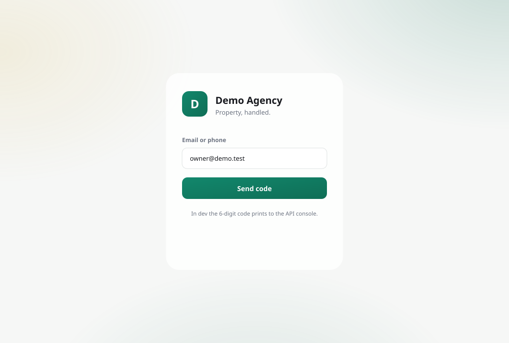

Sign-in is passwordless: you are sent a one-time code instead of using a password.

**How do I sign in?** Enter your work email address or mobile number and press **Send code**, then type the six-digit code you receive. Write a mobile number in international format, starting +27.

**How long does a sign-in code last?** A few minutes; the message that carries the code says exactly how long. After that, request a new one.

**Why does it say "OTP invalid or expired"?** The code was mistyped, has expired, was already used, or was used up by too many wrong tries. Only the newest code you requested works, so ask for a fresh one.

**Why did I get a new code but the old one stopped working?** Each request replaces the previous code. Use the newest one.

**What does "Remember this device" do?** It keeps this browser trusted, so next time you are signed straight in without a code. It is ticked by default; untick it on a shared computer.

**Why was I signed out?** You are signed out after a spell of inactivity. A **Still there?** prompt appears about a minute before; press **Stay signed in** to carry on. Moving the mouse, typing or scrolling keeps you signed in, but a screen left open on its own does not.

**What does Sign out do?** It ends your session immediately and forgets this device. The button is at the bottom of the sidebar.

**Why does it say I'm signed in but not linked yet?** Your address is not attached to any agency. Ask your agency administrator to add you.

**How do I add a colleague to the back office?** The back office has no screen for adding staff. Ask your Locare contact to add them to your agency.

**I work for two agencies. How do I switch between them?** You can't switch from the back office: a sign-in opens one agency.

**Can a property manager do everything an agency owner can?** Nearly everything. Only an agency owner can create or revoke API keys.

**Can I sign in with Google?** Only if your installation has Google sign-in turned on. When it is, a Google button shows on the sign-in page.

---

## How your installation is set up
<!-- assistant: #modes -->

Locare runs in one of three ways: **on-site, back office** (on your own server,
sealed off from the internet), **on-site, connected** (on your own server, with
one address published to the internet), or on a **private server** run for you.
The way it runs decides a few things staff notice.

**How do I know how our installation runs?** A label under your logo reads **On-site, back office** or **On-site, connected**. A private server shows no label.

**Why are Listings and Applications missing from the menu?** Your installation is on-site, back office. It does not publish listings to the internet, so those screens are left out rather than greyed out.

**What does "This installation … does not serve this" mean?** You tried something your installation does not provide, such as public listings on a sealed on-site install. It is not something you can fix from the screen.

**Can tenants and landlords sign in?** Not on an on-site, back office installation: they are told to contact the managing agent. On the other two they can.

**How are leases signed on an on-site, back office installation?** By print and sign. No signing email goes to the tenant; you print the agreement and have it signed on paper.

**How is rent collected on an on-site, back office installation?** By recording payments by hand and by importing your bank statement. Card and instant-EFT payment is not available there.

---

## Dashboard
<!-- assistant: / -->

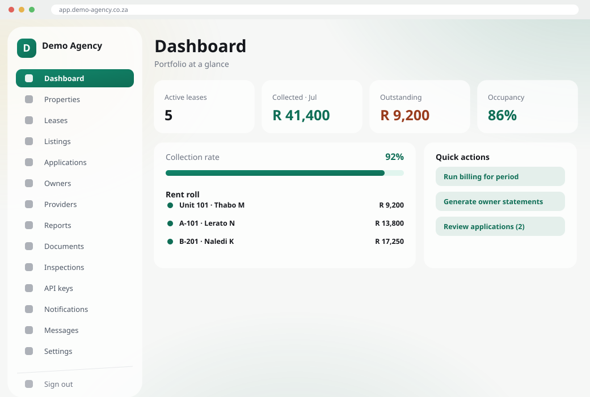

How the month is tracking: what was billed and collected for a period, what is still owed and by whom, occupancy, leases to renew and open maintenance jobs.

**What does the collection rate compare?** What tenants paid against the selected month's invoices, as a share of what those invoices billed. A payment counts only for the part that landed on that month's invoices.

**What does Run billing do?** It raises the rent invoice for the selected month on every active lease that does not have one yet, due on the 7th. Running it twice is safe: a lease never gets two invoices for the same month.

**When do rent invoices go out?** They are meant to be raised automatically early on the 1st of every month, due on the 7th, and the tenant is notified as each one is raised. Check the dashboard early each month: if the month's invoices are missing, choose that month and press **Run billing**.

**What is on a rent invoice?** The month's rent, plus a tax line where tax applies. Utilities are not added to rent invoices.

**What happens when rent is paid late?** The day after the due date, an unpaid or part-paid invoice is marked overdue, a one-off late fee is recorded in the books, and the tenant is sent an overdue notice by app, SMS and email. The fee is not added to the invoice, so it does not appear in the amounts owed on these screens.

**What is "Outstanding by age"?** Everything still owed, grouped by how far past its due date it is: not yet due, then 0–30, 31–60, 61–90 and over 90 days. Part-payments are already taken off.

**What is "Worst first"?** The six active leases that owe the most, largest first, so you can see who to chase. **All leases** opens the full list.

**Why is the occupancy here different from the Properties screen?** The dashboard counts a unit as occupied only when it has a live lease and its status is not vacant; the Properties screen counts the status set on each unit.

**What does "Expiring in 90 days" count?** Units whose lease ends within 90 days, unless something more serious is flagged on them, such as arrears over 30 days, a vacancy or an urgent maintenance job. The Portfolio map shows every flag on every unit.

**What does "Open jobs" count?** Maintenance jobs that are open or assigned to a provider.

**Why can't I see a Record payment button?** It only appears on an on-site, back office installation, where payments are recorded by hand, and only on a Worst first row that owes money. Elsewhere, payments arrive through the payment gateway, proofs of payment or a bank-statement import.

**How do I record a payment by hand?** Press **Record payment** on the lease's row, pick the invoice, enter the amount and whether it was cash or EFT, and add a reference. The payment is dated the day you record it, and the tenant is told it was received.

**Why does it warn me about cash?** Cash is recorded on your word alone. It will not appear on a bank statement until it is banked.

**Why does it say "Invoice already paid"?** That invoice is already settled, so nothing more can be recorded against it.

---

## Properties & Units
<!-- assistant: /properties -->

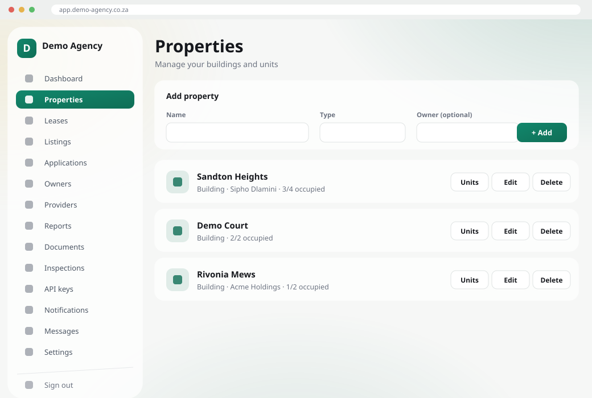

Your buildings and the units in them.

**How do I add a property?** Enter its name and type, and optionally its owner, at the top of the screen. Then open the property to add its units.

**What property types are there?** Building, complex, single unit and co-living.

**What do the unit statuses mean?** Vacant, occupied, maintenance, reserved and offline. A new unit is vacant unless you pick another status when you add it.

**Does a unit's status change by itself?** It becomes occupied when you add a tenant to it or approve an application for it. Nothing sets it back to vacant when a tenant leaves, so change it yourself.

**Can I change a unit's status by hand?** Yes. Edit the unit and pick the status.

**What can I record about a unit?** Its name, status, market rent, bedrooms, bathrooms and size in square metres.

**Why can't I delete this property?** A property that still has units can't be deleted. Remove its units first.

**Why can't I delete this unit?** It has an active lease, and a unit with an active lease can't be deleted.

**Why does it say a unit with that name already exists?** Unit names must be unique within a property, ignoring capital letters and spaces at either end.

**Is a deleted property or unit gone for good?** It disappears from your screens, but the record is kept.

**What does the occupancy figure on this screen count?** Units whose status is occupied, out of all your units. It goes by the status you set, not by leases.

**Can I record a property's address?** Not on this screen yet.

---

## Leases
<!-- assistant: /leases -->

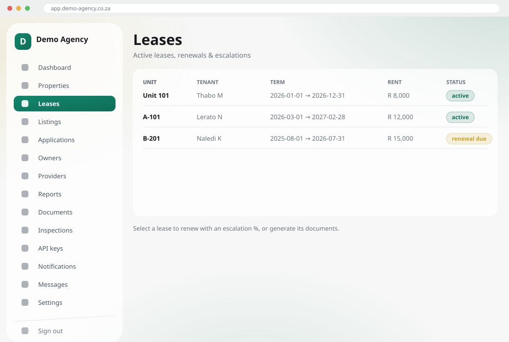

Your active leases: put a tenant into a unit, send the lease for signing, and renew.

**Why don't I see old or draft leases?** This list shows active leases only.

**What happens when I add a tenant?** In one step the tenant's account is created, an active lease starts, the unit becomes occupied, the first rent invoice is raised, and the lease agreement is generated and, except on an on-site, back office installation, emailed to the tenant to sign. If you pick a referring agent, their commission is recorded too.

**Does Add tenant check that the unit is empty?** No. The lease is created on whichever unit you choose, so pick a vacant one.

**Why won't it let me add the tenant?** The tenant's email, a unit, a rent above zero and a start date are all required.

**How is the first month charged when a lease starts mid-month?** Pro rata, for the days from the start date to the end of that month. That first invoice is due on the start date.

**How do I send the lease for signing?** Adding a tenant already sends it, so the lease's row shows **Awaiting signature** with buttons to copy the signing link or open the signing page. **Send lease** appears only on a lease that has no agreement yet. Except on an on-site, back office installation, the tenant is emailed the link.

**How does the tenant sign?** They open the signing link and type their full name. The time and their network address are recorded with the signature.

**When can the tenant use their app or portal?** A tenant added on this screen or through Import lease can sign in straight away. An applicant approved on the Applications screen can sign in only after signing the lease agreement; until then the sign-in screen asks them to sign first and offers to email the link again. On an on-site, back office installation tenants can't sign in at all.

**How do I renew a lease?** Press **Renew**, set the escalation percentage and how many months to extend, then **Apply renewal**. The form starts at 8% and 12 months, so check both. The new term runs on from the current end date, or from today if the lease has none.

**How is the new rent worked out?** The current rent increased by the escalation percentage, rounded to the nearest rand. Set the percentage to 0 to extend without an increase.

**When does a renewed rent take effect?** From the next invoice raised for the lease. Renewing does not raise an invoice or send a new agreement.

**Is rent escalated automatically every year?** No. The rent changes only when someone renews the lease.

**How do I end a lease?** The back office has no action to end or terminate a lease yet. Until there is one, the lease stays active and keeps being invoiced every month, even after its end date.

**Can we use our own lease wording?** Yes. Upload your lease as a PDF, or write a template, under **Settings → Lease agreement**. Until you do, a built-in starter lease is used.

---

## Import lease
<!-- assistant: /lease-parsing -->

Upload an existing lease as a PDF. AI pulls out the tenant, rent and dates for you to check before anything is created; the deposit it finds is shown for reference but not recorded.

**What kind of lease file can I import?** A digital PDF with selectable text, up to 20 MB. Scans and photos can't be read: this version has no text recognition.

**Why did my lease import fail?** Most likely the PDF is a scanned image with no selectable text. Upload the digital version of the lease instead.

**Is anything saved when I upload a lease?** No tenant or lease is created until you review the details and confirm.

**Can I trust what the AI extracted?** Check every field, because AI can misread. Pick the matching unit yourself.

**What does Confirm & create tenant do?** The same as **Add tenant** on the Leases screen, using the details as you corrected them: it creates the tenant, the lease, the first rent invoice and the lease agreement. The deposit is not recorded, and the unit is not checked for an existing tenant.

---

## Payments
<!-- assistant: /payments -->

Proofs of payment that tenants have uploaded against their invoices, waiting for you to accept or reject.

**What is on this screen?** Proofs of payment tenants have uploaded against their invoices. Pending ones are listed first, and you can filter by status.

**What does Accept do?** It records a payment against the invoice for the amount the tenant stated, or for the full invoice total if they gave none, and tells the tenant the payment is confirmed. If the invoice is already part-paid and no amount was given, reject it and ask for the amount, because Accept would record the full total.

**What does Reject do?** It sends your reason to the tenant and asks them to submit again.

**Why does it say "Already accepted"?** Someone has already reviewed that proof. Each proof is reviewed once.

**Why is this screen empty on an on-site, back office installation?** Tenants can't sign in there, so they can't upload proofs of payment.

---

## Bank statement
<!-- assistant: /statements -->

Upload your bank statement, match its incoming payments to open rent invoices, and record them in one go.

**Is this where owner statements are made?** No. This screen matches your bank statement against tenants' invoices. Owner statements are made on the Owners screen.

**What file can I upload?** A CSV or .xlsx file exported from your bank, up to 8 MB. Older .xls files can't be read; save them as .xlsx or CSV first.

**Does uploading record anything?** No. Uploading only shows the proposed matches; nothing is recorded until you press **Record**.

**How does it match a statement line to an invoice?** First by the invoice's payment reference appearing in the line. Failing that, by amount: exactly one open invoice owing that exact amount, due within 10 days of the payment.

**Why wasn't a line matched?** Lines that are not money in are skipped. A line also stays unmatched when no open invoice fits, when two invoices fit the same amount (it never guesses between them), or when another line already claimed that invoice.

**Can I leave a match out?** Yes. Press **Skip** on that row; only the rows you keep are recorded.

**What happens when I press Record?** Each match is recorded as an EFT payment against its invoice, dated the day you record it rather than the statement date. If one fails, the rest still go through and the failures are listed.

**Why were some rows unreadable?** The file had no date column or no amount column, or a row's date or amount could not be read. Export the statement again from your bank as CSV or Excel.

**Does this work on every installation?** Yes. Reconciling a bank statement is back-office work, whatever the installation.

---

## Listings
<!-- assistant: /listings -->

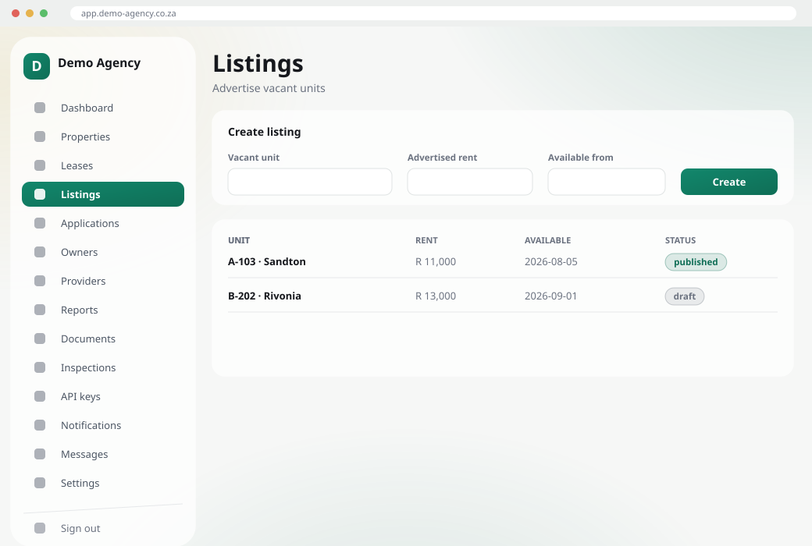

Advertise vacant units on your rentals site.

**How do I list a vacant unit?** Pick the unit, fill in the deposit, admin fee, available-from date and description, and press **Create & publish**. The listing goes live straight away.

**Why isn't my unit in the list?** Only vacant units without an open listing appear.

**Can I advertise a different rent?** No. A listing uses the unit's market rent; change it on the unit.

**Why does it say this unit already has an active listing?** A unit can have only one open listing at a time. Close the existing one first.

**How do I take a listing down?** **Pause** a published listing to take it down for now, or **Close** it. **Publish** puts a paused or closed listing back up.

**How do I share a listing?** Use **Copy link** or **Open public page** on a published listing. The link points to your rentals site.

**What photos can I add?** JPG, PNG or WebP images, up to 10 MB each. The first photo is the cover.

**What happens to the listing when the unit is let?** Approving an application for it marks the listing filled.

---

## Applications
<!-- assistant: /applications -->

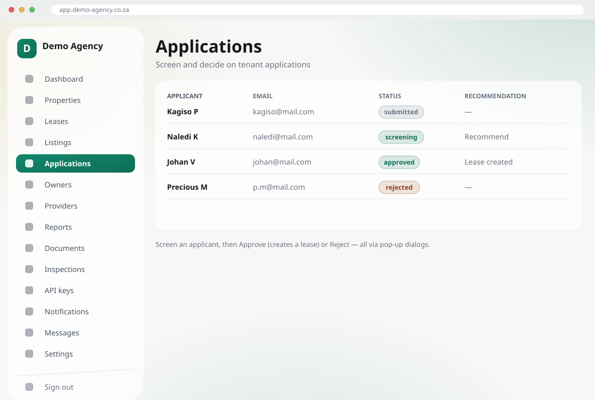

People who have applied for your listings, and your decisions on them.

**What stages does an application go through?** Submitted, then screening once you press **Screen**, then approved or rejected.

**What does Screen work out?** It compares the applicant's monthly income with the advertised rent and checks the credit score. Income of at least 3 times the rent with a score of 650 or more recommends approve; income under 3 times the rent or a score below 550 recommends decline; anything in between recommends review.

**Do I have to follow the recommendation?** No. It is advice; the decision is yours.

**Why did screening recommend decline for an applicant who looks fine?** A blank credit score counts as zero, which always recommends decline. Enter both the income and the credit score.

**Why can't I approve an application yet?** It must be screened first. **Approve** appears once screening is done.

**What does Approve do?** It creates the tenant's account and an active lease from your start date, marks the unit occupied and the listing filled, and raises the first rent invoice. The applicant is sent a welcome message with the lease signing link and a move-in statement of rent, admin fee and deposit; only the rent is invoiced.

**What start date should I use?** Approve suggests one week from today; change it to the agreed date.

**Can I undo a rejection?** No. A rejected application stays rejected.

**Why was an application refused because of age?** Applicants must be 18 or older. Age is taken from the date of birth, or from the South African ID number.

**What can I see about an applicant?** **View** shows their ID, date of birth, address, employment, employer, income, occupants, move-in date, pets, consent and message.

---

## Owners
<!-- assistant: /owners -->

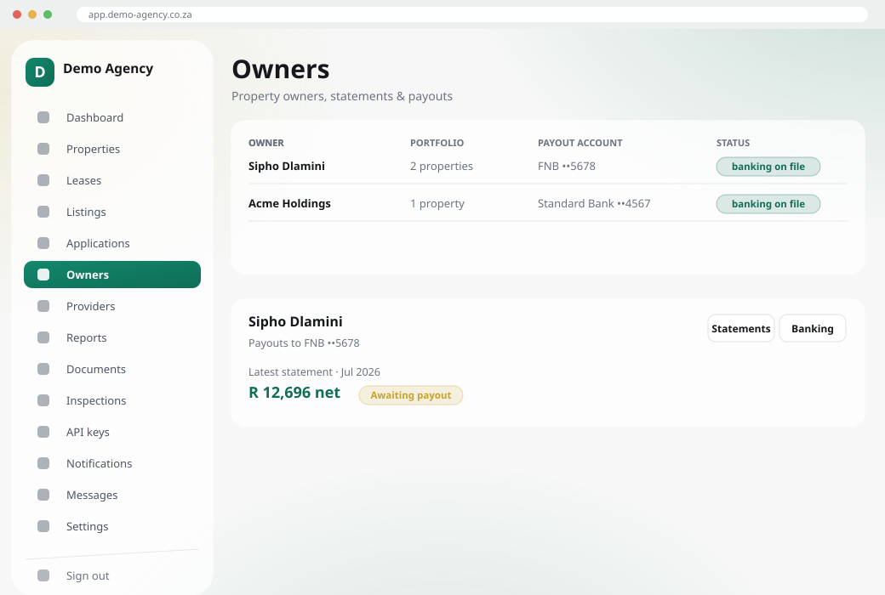

The property owners you manage for: their monthly statements, payouts and bank details.

**How do I add an owner?** Enter their name and management fee, then add them. Enter the fee as a fraction: 0.10 means 10%.

**Can I change an owner's name or fee later?** Not from the back office.

**How do I make an owner's statement?** Open the owner's **Statements**, enter the month as YYYY-MM and press **Generate**. Statements are made one owner and one month at a time; nothing makes them automatically.

**What counts as gross on an owner statement?** Rent tenants paid against that month's invoices on the owner's properties. It goes by the month the invoice is for, not the day the money arrived.

**How are the fee and net worked out?** The fee is gross times the owner's management fee. Expenses are the owner's chargeable expenses for that month not yet recovered. Net is gross less the fee and expenses, and never below zero. If expenses exceed what is left after the fee, the net is zero and the shortfall is not carried to a later statement.

**Can I generate a statement again or reverse it?** No. Each owner has one statement per month, and it can't be regenerated or reversed.

**What do Ready to pay and Paid out mean?** A new statement is ready to pay. Once you pay it out, it shows as paid out.

**Why can't I see the Pay out button?** The statement must be ready to pay with a net above zero, and the owner must have bank details on file. Otherwise the row shows **Add banking first**.

**What does Pay out do?** It asks your installation's payout provider to pay the net into the owner's account, records the payout in the books and marks the statement paid out. If payouts are not live on your installation, no money is sent even though the statement shows paid out: ask your administrator, and if they are not live, pay the owner yourself and then use Pay out to record it.

**Why are owners' account numbers hidden?** Account numbers are masked in the list. The full number is fetched only when you open the banking editor, and bank details are encrypted at rest.

**Can owners update their own bank details?** Yes, in the Owner Portal, except on an on-site, back office installation, where owners can't sign in. The change applies at once, with no approval or notice to staff, and the next payout uses it, so check an owner's banking before paying out.

---

## Agents
<!-- assistant: /agents -->

Referral agents who introduce tenants or properties to you, and the commission you owe them.

**Who are agents?** People or firms who refer tenants or properties to you for a commission. They are not your staff and do not sign in.

**What commission terms can an agent have?** A flat amount in rands, or a percentage of the first month's rent.

**How is a commission recorded?** Automatically, when you add a tenant and pick the referring agent. You can also record one by hand with **Commission**.

**Should I enter the amount when recording a commission by hand?** Yes, for an agent paid a percentage. Left blank, the agent's default is used as a flat amount, which is only right for a flat-fee agent.

**What stages does a commission go through?** Pending, approved and paid. A commission can also be cancelled.

**Does Mark paid pay the agent?** No. It records that you have paid them, with an optional EFT reference. Make the payment yourself.

**Why can't I cancel a commission?** A paid commission can't be cancelled.

**Can I delete an agent?** No. Deactivate them instead; you can activate them again later.

**What is on an agent's statement?** Their pending, approved and paid totals, and every commission.

---

## Service Providers
<!-- assistant: /providers -->

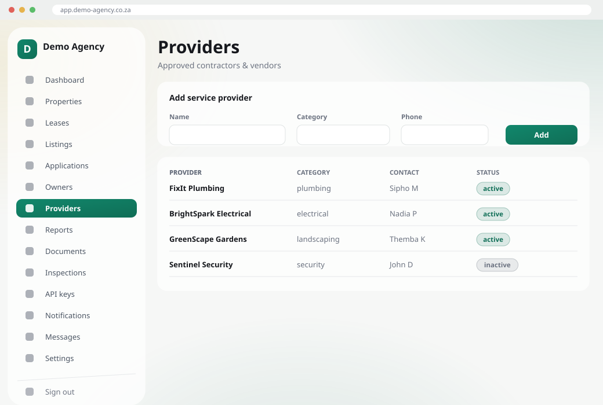

Your approved contractors: maintenance, plumbing, electrical, landscaping, cleaning, security, legal and more.

**What can I record about a provider?** Their name, category, contact person, phone and email.

**Can I delete a provider?** No. Deactivate them instead; you can activate them again later. Deactivating only marks them inactive here: they can still be chosen for a job in the landlord app.

**Are providers matched to maintenance jobs automatically?** No. Whoever assigns a job chooses the provider.

**Where are maintenance jobs assigned?** In the landlord app. The back office shows open jobs on the Dashboard and the Portfolio map.

---

## Portfolio map
<!-- assistant: /gods-eye -->

Where the portfolio needs attention. Each unit is coloured by its most pressing problem; open a property to see its units.

**What do the colours mean?** Each unit takes the colour of its most pressing problem, from worst: arrears over 90 days, arrears 61–90 days, lease expired, vacant, arrears 31–60 days, urgent maintenance, lease expiring, arrears up to 30 days, open maintenance, inspection overdue, offline, then all clear.

**A unit has several problems. Which one shows?** The colour shows the worst one; the others still appear as flags on the unit.

**When is a unit in arrears?** When its live lease has an unpaid invoice past its due date. The bucket comes from the oldest unpaid due date.

**When is a lease expiring?** When it ends within the next 90 days. Once the end date has passed, it shows as lease expired.

**Why does a unit show as never inspected or inspection overdue?** Never inspected means it has no completed or signed-off inspection; drafts don't count. Overdue means the last one was more than 365 days ago.

**Why does a unit marked occupied show as vacant here?** The map treats a unit as let only when it has a live lease and its status is not vacant. A unit without a live lease shows as vacant, unless its status is offline or under maintenance.

**Can I see the map as it was on an earlier date?** No. The map always shows current leases, arrears and jobs. **Copy link** copies your current filters and selection to share.

---

## Reports
<!-- assistant: /reports -->

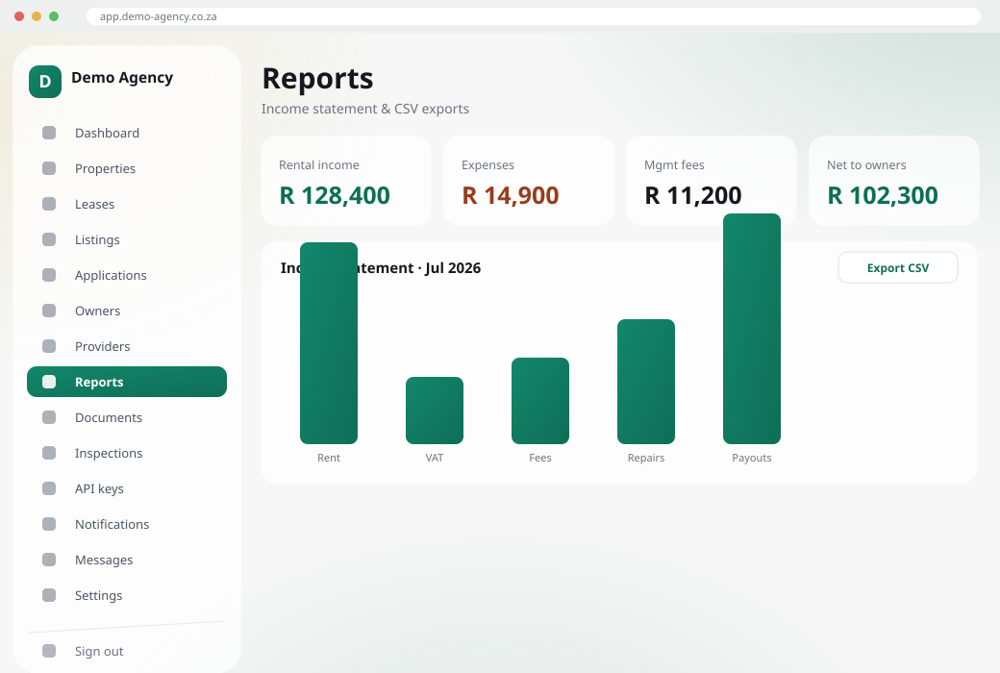

A month's income summary, the collection rate, and three exports for your bookkeeper.

**How do I run a report?** Enter the month as YYYY-MM and press **Run**.

**What is "Rent collected"?** Payments tenants made against that month's invoices.

**Why are management fees zero?** Management fees come from owner statements. Generate that month's owner statements first.

**How is net operating worked out?** Rent collected plus management fees, less expenses for the month.

**What exports are there?** Rent roll, arrears ageing and collection, each as a CSV file.

**What is in the rent roll export?** One row per active lease: lease, unit, tenant reference, rent, status and amount outstanding after part-payments.

**Does the month I choose change the rent roll or arrears export?** No. Those two are as of today; the month only appears in the file name.

**Is there an owner statement or payout export?** No. Reports has three exports: rent roll, arrears ageing and collection. Utilities has its own recovery-gap export.

---

## Documents & e-sign
<!-- assistant: /documents -->

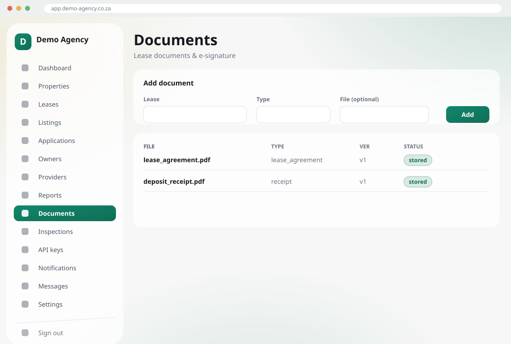

Files kept against a lease, such as agreements, receipts and notices, with versions and signature requests.

**How do I add a document?** Pick the lease, give the document type, choose the file and press **Add**. Only active leases are listed. Make sure you choose a file: Add without one still creates an entry with nothing in it.

**What are versions?** Adding another document of the same type to the same lease makes it the next version. Earlier versions are kept.

**How do I get a document signed?** Press **Send to sign**, enter the signer's email and name, and a signing link is shown for you to share. On an on-site, back office installation the link opens a copy to print and sign by hand.

**Can I see here whether a document has been signed?** No. Signature status is not shown here, and Stored only means the entry was added. Use Download to check the file is there.

---

## Inspections
<!-- assistant: /inspections -->

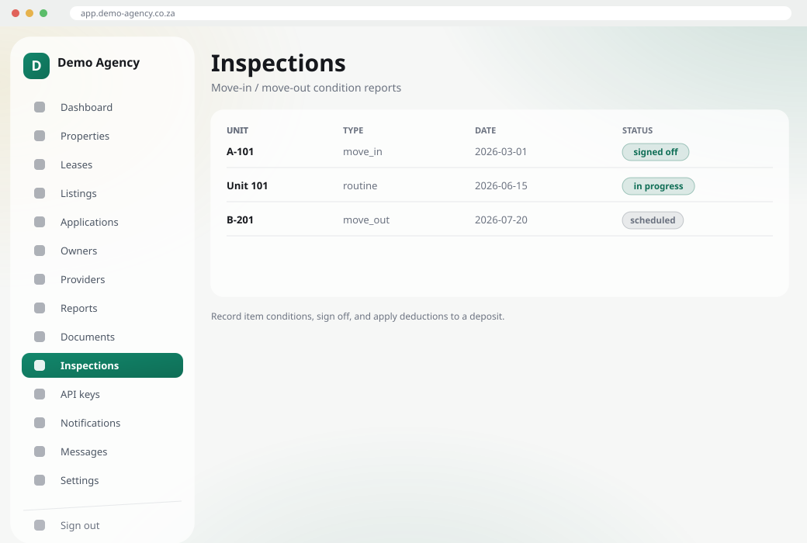

Move-in, move-out and periodic condition reports.

**What kinds of inspection are there?** Move-in, move-out and periodic.

**How do I complete an inspection?** Press **Record items** and, for each area, set the condition (good, fair, poor or damaged), any deduction amount and photos. Saving marks the inspection completed, dated today.

**What does Sign off do?** It marks the inspection signed off and records that the tenant agreed. It collects no signature from the tenant, so press it only once they have agreed. It appears only on a completed inspection, and afterwards this screen no longer offers Record items.

**Does signing off take the deductions from the deposit?** No. Sign-off does not touch the deposit, and the back office has no screen for applying deductions to a deposit yet.

**How often should units be inspected?** The Portfolio map flags a unit as overdue when its last completed inspection is more than 365 days old.

---

## Utilities
<!-- assistant: /utilities -->

Municipal meters and the readings taken against them. **Recorded only — nothing
here bills a tenant**; the figures feed the recovery gap and your own reporting.

**Meters** attach either to a unit (a **submeter**) or to a property (a **bulk
meter**). Electricity, water and gas are metered. Sewerage and refuse are not —
there is no dial to read, so those need the cost for the period entered directly.

**Does anything here bill a tenant?** No. Readings are recorded for your own reporting and the recovery gap; nothing is charged to a tenant.

**Should a meter be on the unit or the property?** A meter on a unit is a submeter; a meter on a property is the bulk meter. A meter belongs to exactly one of the two.

**How is consumption worked out?** The difference from the previous reading, times the meter's multiplier (the CT ratio, which is 1 on every domestic meter). It is never taken from the form.

**Why does the first reading show no consumption?** The first reading on a meter is a baseline. There is no earlier reading to measure from.

**Why was my reading refused?** A reading lower than the previous one is refused, because a meter that wrapped and a typing error look the same. A reading dated before one already captured, or on a removed meter, is refused too.

**What if the meter rolled over?** Tick **The meter rolled over**, and the wrap is worked out from the meter's dial digits. Set the dial digits when you add the meter.

**How do I capture sewerage or refuse?** Enter the cost for the period. Those services have no dial to read.

**How is the cost of a reading worked out?** A cost you type is used as given. Otherwise, if you enter a tariff per unit, the cost is consumption times the tariff.

**When can I mark a reading as estimated?** On metered utilities, when nobody read the meter: tick **Estimated, not read**.

**What is the recovery gap?** For each property and month, the bulk meter's consumption less the total of the submeters beneath it. It is what you paid the municipality for and did not recover: common-area use, losses and leaks.

**Why does the recovery gap show no figure?** Both sides are needed. With no bulk reading or no submeter readings for that month, it shows a note rather than treating the missing side as zero.

**Can I remove a meter?** Not from this screen.

---

## Messages
<!-- assistant: /messages -->

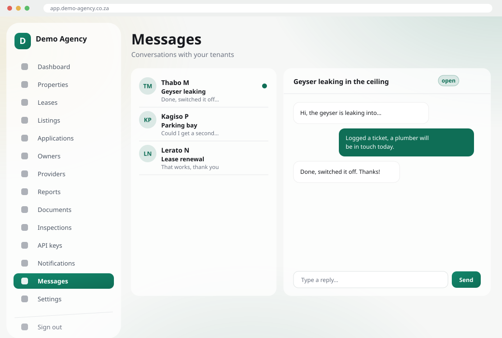

Two-way conversations with your tenants.

**Who can see a conversation?** All staff in your agency see every conversation. A tenant sees only their own.

**How do new messages arrive?** Live: new tenant messages appear without refreshing the page.

**What does the unread marker mean?** The conversation has a message newer than the last time anyone on your staff opened it. Read status is shared by all staff, not kept per person.

**How do I close a conversation?** Press **Close**. A new reply from either side reopens it.

**Can I start a new conversation with a tenant?** Not from this screen. Conversations start when a tenant writes in.

**Does a new message send the tenant an email or SMS?** No. Messages stay in the app.

**How do I send without starting a new line?** Press Enter to send, and Shift+Enter for a new line.

---

## Notifications
<!-- assistant: /notifications -->

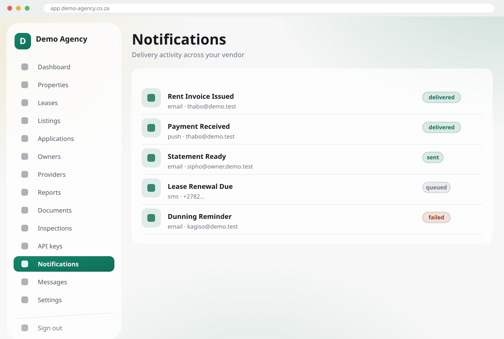

A log of the messages the system has sent your tenants and staff.

**What does this screen show?** The latest 40 messages the system sent, newest first, with the channel and status of each.

**What does the system send, and when?** A rent invoice notice when an invoice is raised, a payment-received notice when a payment is recorded or confirmed, an overdue notice when an invoice goes overdue, and debit-order notices when a debit order stops collecting.

**What does Failed mean?** That channel could not deliver the message: either no provider is set up for it on your installation, or the provider refused it. A failed channel is not retried.

**Why did a tenant not get an SMS?** SMS is only used for overdue and debit-order notices. Every message goes to the tenant's email address if they have one, and to their phone only if they have no email, so a tenant with an email address on file is unlikely to get an SMS. A Failed row means no provider is set up for that channel or the provider refused it.

**Can I resend a message from here?** No. This screen is a log only.

---

## API keys
<!-- assistant: /api-keys -->

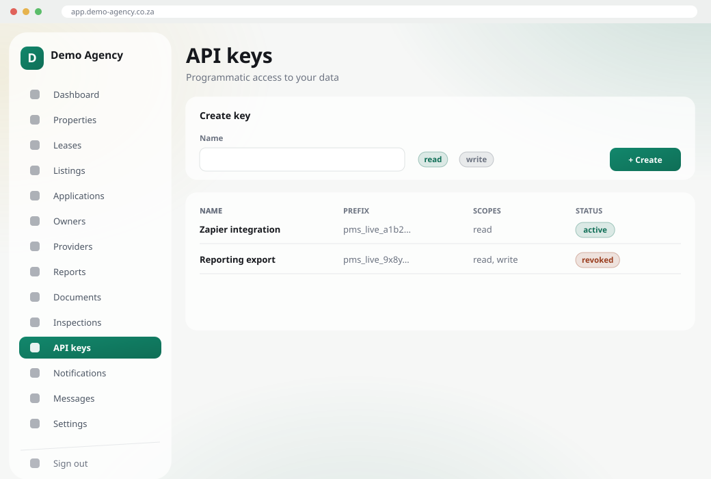

Keys that let another system read your agency's data.

**Who can manage API keys?** Only an agency owner. A property manager sees the menu item but is refused.

**How do I create a key?** Give it a name, choose its scopes and create it. The full key is shown once only, so copy it immediately. Scopes are recorded but change nothing yet: every key can only read the rent roll.

**What can a key do?** It lets another system read your rent roll.

**How do I stop a key working?** Revoke it. Revoking takes effect immediately and can't be undone.

**Can I set a key to expire?** Not from this screen.

---

## Settings
<!-- assistant: /settings -->

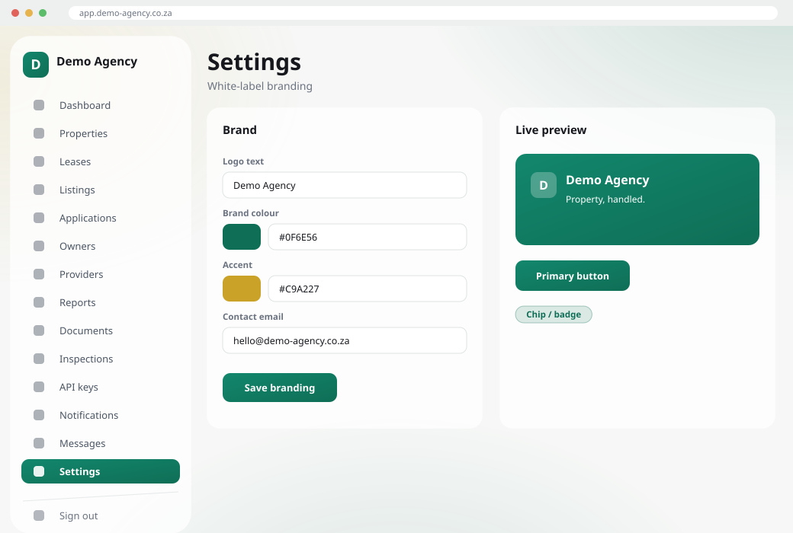

Your agency's branding, contact details and lease agreement.

**What can I change in Settings?** Your display name, tagline, logos, fonts, colours, contact details and lease agreement. The top of the page also shows how many units and properties you manage.

**How do I add our logo?** Paste the web address of the logo image. Logos are added by link, not uploaded.

**When do branding changes show?** The back office changes as soon as you save. The mobile apps pick it up the next time they reload.

**How do I use our own lease?** Upload it as a PDF or an image under **Lease agreement**; new tenants are sent it to sign. **Remove** goes back to your advanced text template if you saved one, otherwise to the built-in starter lease.

**Does the number of units we manage limit anything?** No. It is shown for your information, and it is what your Locare plan on the Billing screen is worked out from.

**Where do I add staff users?** There is no users section in Settings. Ask your Locare contact to add them to your agency.

**Where do I change the language?** At the bottom of the sidebar, not in Settings.

---

## Billing
<!-- assistant: /billing -->

Your agency's own Locare plan and its monthly invoices.

**How is our plan worked out?** From the number of units you manage, as last counted. Opening this page recounts them, and the monthly invoice uses the latest count saved. Your tier and monthly fee are shown at the top.

**What does "By arrangement" mean?** Your agency is below the smallest standard plan, so no invoice is raised until a price is agreed with Locare.

**When are our Locare invoices raised?** Automatically early on the 1st of each month, due on the 7th, for agencies with a priced plan.

**How do we pay our Locare invoice?** Press **Pay** on an issued invoice, or pay by EFT using the bank details and reference shown on this page while an invoice is unpaid.

**Why is our EFT payment not showing yet?** Allow a working day for an EFT to show as paid.

**Can we change our plan or agree a different price here?** No. An agreed price is set by Locare and shows as "Monthly fee (agreed)".

---

## Language
<!-- assistant: #language -->

The language the back office is shown in, where your installation offers more than one.

**How do I change the language?** Use the language list at the bottom of the sidebar, above **Sign out**.

**Why can't I see a language option?** Your installation offers one language only, so the list is hidden.

**What changes when I switch language?** Menus and screens, plus number, money and date formats. Your choice is remembered in this browser only.

**Why are some screens still in English?** Wording not yet translated falls back to English, and so do error messages, the sign-in screen and notification names.

---

## Owner Portal
<!-- assistant: #owner-portal -->

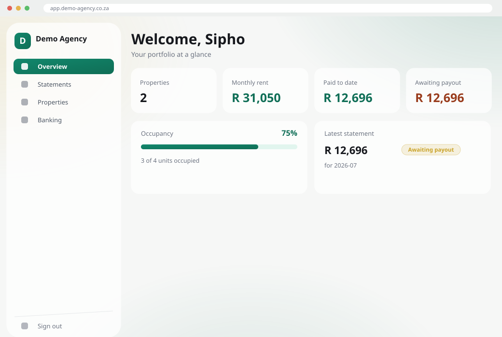

When a **property owner** signs in they land in the Owner Portal instead of the
back office, seeing only their own data. The overview shows portfolio size,
monthly rent, amounts paid to date and awaiting payout, occupancy, and their
latest statement. The portal's own menu — **Overview, Statements, Properties,
Banking** — lets owners review statements and payouts, see their properties'
occupancy, and keep their payout bank details up to date.

**What can an owner see in the Owner Portal?** Only their own data: an overview, their statements and payouts, their properties' occupancy and their bank details. They never see other owners or the back office.

**Can an owner change their own bank details?** Yes, under **Banking** in the Owner Portal. The change applies at once, with no approval or notice to staff, and the next payout uses it.

**Why can't an owner sign in?** On an on-site, back office installation, owners can't sign in; they are told to contact the managing agent.

---

*Runs on Locare (PMS 0.3). For setup and running instructions see `RUN.md`; for
deployment see `DEPLOY.md`.*
